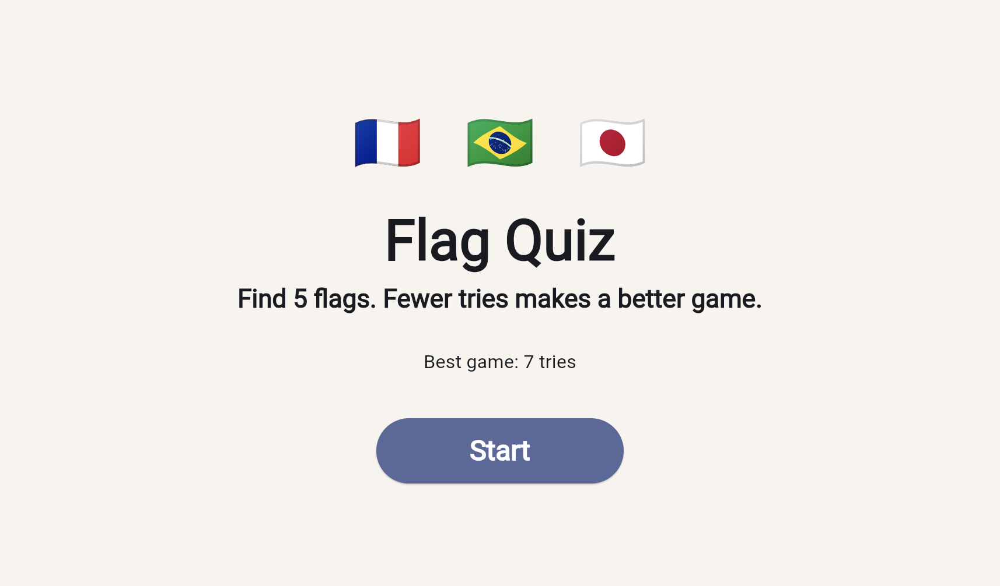
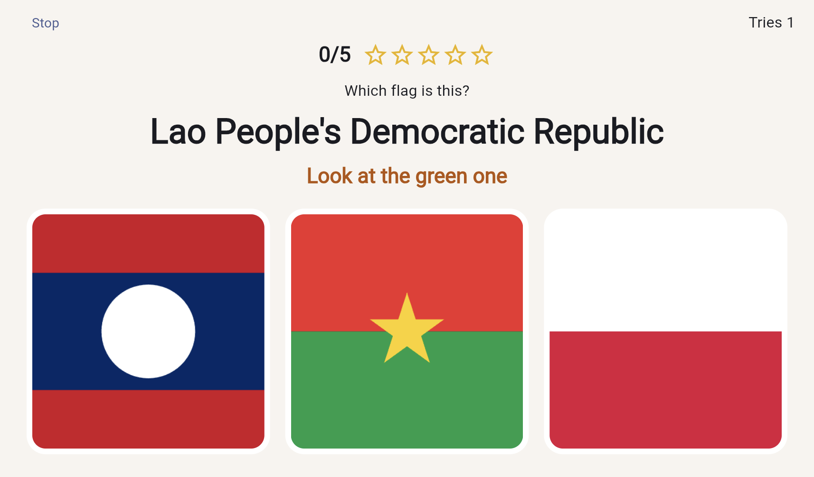
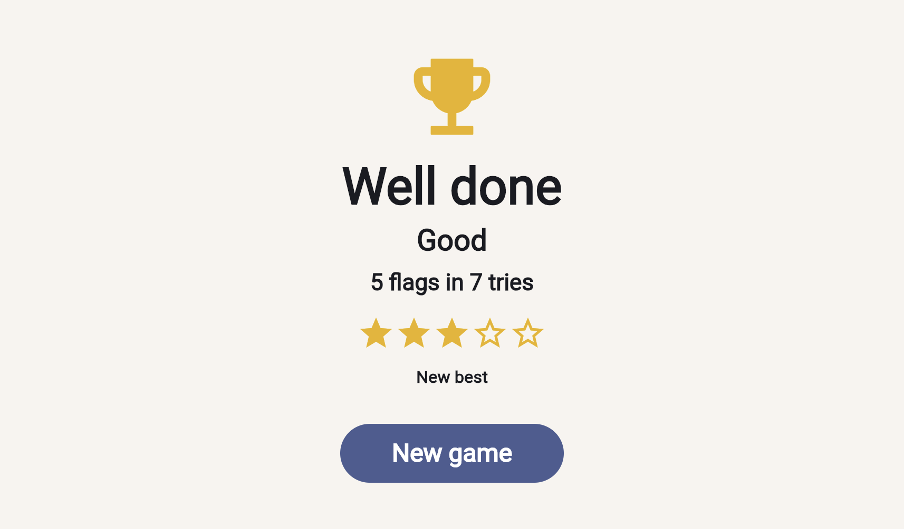

# Flag Quiz

A small game for learning flags, built to be played on an iPad.

A round shows a country and three flags. It is over when you have 5 correct answers. A miss stays in the round, and the score is how many tries those 5 answers took. Fewer tries is a better game. A perfect round is 5 tries.

The best score is remembered on the device.



A wrong flag stays on screen long enough to see the right one, outlined in green.





## Play

```sh
flutter pub get
flutter run
```

The country list is bundled with the app. Flag pictures are loaded from [flagcdn.com](https://flagcdn.com), so the device needs a network connection during a round.

## Rating

| Tries | Rating |
| --- | --- |
| 5 | Perfect, 5 stars |
| 6 | Great, 4 stars |
| 7–8 | Good, 3 stars |
| 9–11 | Nice work, 2 stars |
| 12 or more | You did it, 1 star |

## Project layout

The rules live in `lib/game` and do not import Flutter. `lib/ui` is the screens. Tests cover the round, the saved score, and a full game from the start button to the celebration.

```sh
flutter test
flutter analyze
```
